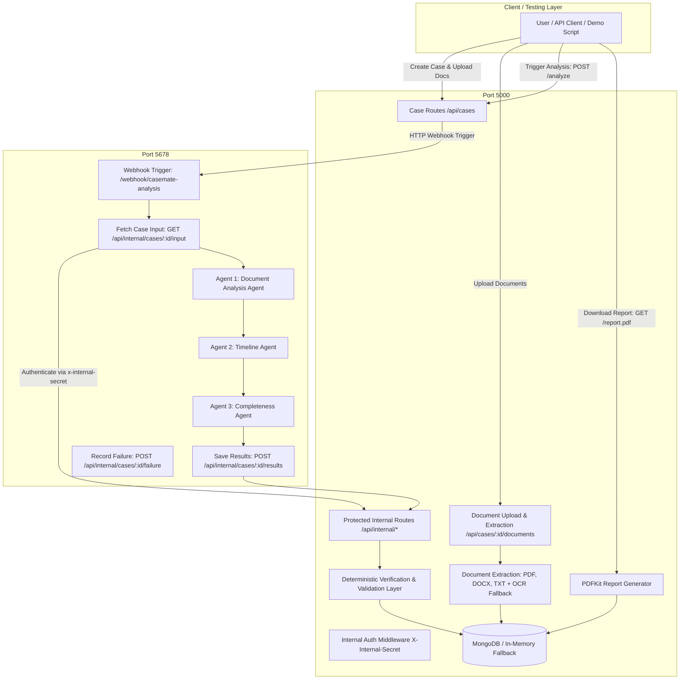

# CustodyLens 479 — AI-Assisted Undertrial Detention Review
### GDG Chennai DevFest on Campus 2026 — Courts, Legal Aid & Justice Services Track

**CustodyLens 479** helps authorized legal-aid reviewers, DLSA panel advocates, and jail visiting counsel examine fragmented case documents, reconstruct an undertrial custody timeline, detect conflicting dates and missing records, calculate custody duration using deterministic calendar-aware arithmetic, and prepare a verified draft review brief under **Section 479 of the Bharatiya Nagarik Suraksha Sanhita (BNSS), 2023**.

> [!IMPORTANT]
> **Human Review Assistance Disclaimer**: CustodyLens 479 assists human legal-aid review and does **NOT** make judicial bail, release, or sentencing decisions. All outputs are presented as administrative draft briefs requiring independent verification by authorized legal counsel before submission to a court of law.

---

## ⚡ Quickstart — Run Frontend (Presentation & Judging)

```powershell
# In a new terminal:
cd frontend
npm install
npm run dev
```
Open **`http://localhost:5173`** (or the displayed Vite port, e.g. `http://localhost:5174`) in your browser.

---

## 🎯 2-3 Minute Hackathon Judge Presentation Sequence

Follow this simple flow to demonstrate the core value of CustodyLens 479 in under 3 minutes:

1. **Overview Dashboard**:
   - Open `http://localhost:5174/` to view active case metrics, Section 479 candidate stats, discrepancy counts, and the real-time audit feed.
2. **Instant Demo Launch**:
   - Click **"Load Judging Demo Case"** in the top navigation bar to load *State of Tamil Nadu vs. Raju Kumar*.
3. **Ingested Records & Grounded Facts**:
   - View the 3 parsed legal records (*FIR No. 104/2025*, *Arrest Memo*, *Magistrate Remand Order*).
   - Under **Extracted Material Facts**, click any **Evidence Citation Chip** (e.g. `case1_fir_theft.pdf`) to open the **Source Evidence Modal** showing verbatim text quotes and exact page references.
4. **Custody Timeline & Milestone**:
   - Switch to the **"Custody Timeline"** tab. Observe the chronological stepper from initial arrest (14-Aug-2025 21:00) to Magistrate production (15-Aug-2025 11:30 AM — within 24h limit) and the **1/3rd Milestone Badge** (14-Aug-2026).
5. **Cross-Document Discrepancy Detection**:
   - Click the **"Suresh Babu (48h Discrepancy)"** selector in the top bar.
   - Switch to the **"Discrepancies & Gaps"** tab to see the side-by-side comparison of contradictory arrest dates: FIR states *12-May-2024* vs Remand Application states *14-May-2024* (a 48-hour variance requiring judicial clarification).
6. **Section 479 BNSS Assessment & Deterministic Calculation**:
   - Switch back to Raju Kumar and open the **"Section 479 BNSS Assessment"** tab.
   - Inspect the **Deterministic Custody Duration** (423 net days, Explanation to Section 479(1) delay deduction).
   - View the **Section 479(3) Jail Superintendent Statutory Mandate Banner** (active legal obligation for prison authorities).
   - Review the 8-rule statutory checklist (*Capital Exclusion, Multi-Offence Restriction, First-Offender 1/3rd Proviso, etc.*).
7. **Draft Legal-Aid Brief Generation & PDF Export**:
   - Click **"Generate Draft Review Brief"** to preview the complete case dossier, including evidentiary references, recommended next steps for DLSA, and mandatory statutory disclaimers.
   - Click **"Download PDF"** or **"Print"** to export.

---

## 🏛️ System Architecture



---

## 🤖 Coordinated AI-Agent Workflow

1. **Agent 1: Document Analysis Agent**
   - Classifies legal documents (*Notice to Quit, Court Summons, Demand Letter, Lease Agreement, Rent Ledger*).
   - Extracts parties, dates, case/docket numbers, explicitly stated actions, and factual claims.
   - Preserves exact source citations, quotations, and page references.
   - **Security Policy**: Wraps all untrusted document input in strict boundary delimiters; neutralizes and flags adversarial prompt-injection attempts.
   - Integrates with OpenRouter API (or reliable deterministic legal extraction fallback).

2. **Agent 2: Timeline Agent**
   - Normalizes disparate date formats (*Month DD, YYYY*, *MM/DD/YYYY*, *YYYY-MM-DD*) to ISO standard dates.
   - Deterministically sorts dated events chronologically in ascending order.
   - Preserves undated events separately.
   - **Deterministic Date Conflict Detection**: Cross-references assertions across distinct documents (e.g., notice issuance date on Oct 01 vs. letter stating service on Sept 25) without allowing an LLM to hallucinate or silently resolve discrepancies.

3. **Agent 3: Completeness Agent**
   - Compares available documents and facts against configurable legal-aid checklists (*Lease Agreement, Rent Ledger, Proof of Service*).
   - Detects unuploaded referenced documents cited in court summons or complaints.
   - Generates targeted clarification questions for the legal-aid worker and client.
   - Strictly distinguishes missing documents from legally mandatory jurisdictional prerequisites.

4. **Deterministic Verification Layer**
   - Validates outputs against Zod schemas.
   - Validates that every source document ID belongs to the case.
   - Checks that quoted excerpts exist in the raw document text.
   - Automatically transitions cases to `human_review_required` if discrepancies or unresolved issues are detected.

---

## 🐳 Quickstart with Docker (Recommended for Sharing & Teams)

Anyone on your team can run the entire system (**Backend + n8n Orchestrator + MongoDB**) with a single command!

### 1. Clone & Start
**On Windows (PowerShell):**
```powershell
git clone https://github.com/Subhash21022/CaseMate-Ai.git
cd CaseMate-Ai
.\start.ps1
```

**On macOS / Linux:**
```bash
git clone https://github.com/Subhash21022/CaseMate-Ai.git
cd CaseMate-Ai
chmod +x start.sh
./start.sh
```

**Or using Docker Compose directly:**
```bash
cp .env.example .env
docker compose up --build -d
# Import the workflow into n8n
docker compose exec n8n n8n import:workflow --input=/backup/casemate_analysis_workflow.json
docker compose exec n8n n8n publish:workflow --id=CMAnalysis01Work
```

### 2. Available Endpoints
* **Backend API:** `http://localhost:5000`
* **Health Check:** `http://localhost:5000/api/health`
* **n8n Orchestrator:** `http://localhost:5678`
* **MongoDB:** `mongodb://localhost:27017`

---

## 💻 Manual Setup without Docker (Windows PowerShell)

### Prerequisites
- Node.js (v18+)
- npm (v9+)
- (Optional) MongoDB Community Server or MongoDB Atlas (if not running, CaseMate automatically spins up an in-memory MongoDB instance for zero-configuration local development)

### 1. Environment Configuration
The backend comes pre-configured with safe development defaults. Check `backend/.env`:
```env
PORT=5000
NODE_ENV=development
FRONTEND_ORIGIN=http://localhost:5173
MONGODB_URI=mongodb://127.0.0.1:27017/casemate_ai
UPLOAD_DIR=./uploads
MAX_FILE_SIZE=10485760
INTERNAL_API_SECRET=casemate_dev_secret_key_892347
N8N_BASE_URL=http://localhost:5678
N8N_WEBHOOK_PATH=/webhook/casemate-analysis
N8N_USE_TEST_WEBHOOK=false
OPENROUTER_API_KEY=
OPENROUTER_MODEL=anthropic/claude-sonnet-4.5
SUPABASE_URL=https://your-project.supabase.co
SUPABASE_ANON_KEY=your-anon-key
SUPABASE_SERVICE_ROLE_KEY=your-service-role-key
SUPABASE_STORAGE_BUCKET=case-documents
```

### 2. Start the Backend Server
In PowerShell:
```powershell
cd backend
npm install
npm run build
npm run start
```
The backend will start at `http://localhost:5000`.

### 3. Start n8n and Import the Workflow
If n8n is not already running:
```powershell
npx n8n start
```
Import the pre-built workflow into n8n:
```powershell
npx n8n import:workflow --input="n8n/casemate_analysis_workflow.json"
npx n8n publish:workflow --id=CMAnalysis01Work
```
Open `http://localhost:5678` in your browser to inspect or edit the workflow visual graph.

---

## 🧪 Automated Testing & Live Verification

### Run the Vitest Automated Test Suite (45 Tests across 4 Suites)
```powershell
cd backend
npm test
```
**Test Coverage Includes (100% Pass Rate across 45 Tests):**
1. **`section479Rules.test.ts` (11 Tests)**:
   - Capital / life imprisonment exclusion (`Sec 302 IPC`, `Sec 103 BNS`)
   - Multiple pending cases restriction (`Sec 479(2) BNSS`)
   - First-time offender 1/3rd threshold calculation (`Sec 479(1) First Proviso`)
   - General undertrial 1/2nd maximum threshold calculation (`Sec 479(1)`)
   - Accused-caused delay deduction (`Sec 479(1) Explanation`)
   - Jail Superintendent mandatory application triggers (`Sec 479(3)`)
   - Statutory bond conditions and human-review recommendation disclaimers
2. **`custodyCalculator.test.ts` (9 Tests)**:
   - Calendar-aware day arithmetic (inclusive day counting, leap year handling)
   - Continuous police and judicial custody spell merging and deduplication
   - Validating 24-hour statutory magistrate production limit (Article 22(2) & Section 58 BNSS)
   - Contradictory arrest date detection across multiple records
   - Intermittent custody periods and interim bail gap calculations
3. **`custodylensIntegration.test.ts` (11 Tests)**:
   - Case 1: Positive first-time offender (Section 379 IPC theft) qualifying at 1/3rd threshold
   - Case 2: Multi-offence case with 48h conflicting arrest dates and Section 479(2) restriction
   - Case 3: Murder allegation (Section 302 IPC) statutory exclusion
   - Case 4: Adversarial prompt-injection containment in legal record text
   - End-to-end PDF brief generation with mandatory statutory disclaimers
4. **`casemate.test.ts` (14 Tests)**:
   - Health check & database connection
   - Case workspace creation & retrieval
   - Invalid Case ID and 404 validation
   - File upload size & format validation
   - Document extraction & duplicate detection (SHA-256)
   - Prompt injection defense & untrusted input isolation
   - Deterministic date normalization & chronological timeline sorting
   - Date conflict detection across distinct documents
   - Completeness analysis & unuploaded referenced document detection
   - Source quotation & citation verification
   - Protected internal route authentication (`x-internal-secret`)
   - Asynchronous workflow status transitions (`created` -> `documents_uploaded` -> `processing` -> `human_review_required`)
   - n8n workflow failure recording (`/failure`)
   - Structured JSON and downloadable PDF report generation

### Run the Synthetic Sample Data Tests
The repository includes realistic synthetic court records under `sample-data/custodylens/`:
- `case1_fir_theft.pdf` & `case1_arrest_memo.pdf` & `case1_magistrate_remand_order.pdf` (Clean qualifying case)
- `case2_multiple_offences_conflicting_dates.pdf` (Conflicting arrest dates)
- `case3_life_death_exclusion.pdf` (Section 302 IPC Life imprisonment)
- `case4_prompt_injection.pdf` (Adversarial injection attempt)

To generate or rebuild fresh sample PDFs:
```powershell
node sample-data/custodylens/generate_custodylens_samples.cjs
```

### Run the Live End-to-End Demo Script
Execute the native demo script to verify the live integration between the backend, MongoDB, and n8n:
```powershell
node sample-data/test_live_demo.mjs
```
This script automatically:
1. Verifies system health.
2. Creates a case workspace (`Mercer v. Oakridge Residential Tenancy Dispute`).
3. Uploads 3 synthetic documents (`1_notice_to_quit.pdf`, `2_landlord_letter_conflicting_date.txt`, `3_court_summons_referenced_unuploaded.pdf`).
4. Triggers the n8n analysis workflow.
5. Polls status until transition to `human_review_required`.
6. Retrieves the 10-event verified timeline with date conflict warnings.
7. Retrieves the missing-information checklist (flagging missing lease and rent ledger).
8. Downloads the formatted case preparation PDF report to `sample-data/verified_casemate_report.pdf`.

---

## 📚 API Reference

### Public API Endpoints
| Method | Endpoint | Description |
|---|---|---|
| `GET` | `/api/health` | Health check for backend, database, and n8n status |
| `POST` | `/api/cases` | Create a new case workspace (`{ title, category }`) |
| `GET` | `/api/cases/:id` | Retrieve case details, processing status, and document count |
| `POST` | `/api/cases/:id/documents` | Upload a document (`multipart/form-data`) |
| `GET` | `/api/cases/:id/documents` | List uploaded documents with safe metadata (no file paths exposed) |
| `POST` | `/api/cases/:id/analyze` | Trigger the asynchronous analysis workflow |
| `GET` | `/api/cases/:id/timeline` | Retrieve verified chronological timeline and conflict warnings |
| `GET` | `/api/cases/:id/report` | Retrieve structured JSON report data |
| `GET` | `/api/cases/:id/report.pdf` | Download the case preparation PDF report |

### Protected Internal Endpoints (`x-internal-secret`)
| Method | Endpoint | Description |
|---|---|---|
| `GET` | `/api/internal/cases/:id/input` | Fetch case details and extracted document texts for n8n |
| `POST` | `/api/internal/cases/:id/results` | Submit and validate workflow results from n8n |
| `POST` | `/api/internal/cases/:id/failure` | Record workflow failure diagnostics safely |
| `POST` | `/api/internal/agents/document-analysis` | Modular runner for Agent 1 |
| `POST` | `/api/internal/agents/timeline` | Modular runner for Agent 2 |
| `POST` | `/api/internal/agents/completeness` | Modular runner for Agent 3 |

---

## ⚖️ Security and Legal Safety Disclaimers

- **Non-Lawyer Administrative Support**: CaseMate AI is designed exclusively for administrative preparation, issue-spotting, and file organization. It does not provide legal advice, legal strategy, or representation.
- **Untrusted Input Protection**: Uploaded legal documents are treated as untrusted user data. Prompt-injection instructions embedded in documents are isolated and ignored.
- **Deterministic Truth**: Dates, timelines, and conflicts are processed using deterministic code to prevent model hallucination or silent resolution of legal disputes.
- **Protected File Storage**: Raw storage paths and files are kept internal; safe metadata only is returned via the API.
