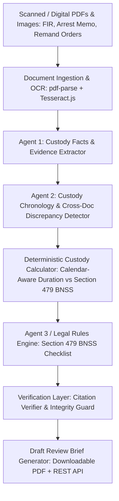

# CustodyLens 479 — Architectural Implementation Plan

## Goal Description
Transform the existing backend into **CustodyLens 479**, an AI-assisted undertrial detention review and legal-aid support system for the **Courts, Legal Aid & Justice Services** track (GDG Chennai DevFest on Campus 2026).
CustodyLens 479 takes fragmented legal documents (FIRs, Arrest Memos, Remand Orders, Charge Sheets), extracts source-grounded facts with verbatim citations, reconstructs a chronological custody timeline, flags evidentiary discrepancies, deterministically calculates custody durations, and evaluates undertrial review eligibility under **Section 479 BNSS (2023)** (including the 1/3rd first-offender proviso and 1/2nd general rule, with exclusions for life/death offenses).

---

## Current Repository Status & Findings
1. **Infrastructure & Stability**:
   - Backend is Node.js + TypeScript + Express + Mongoose + Vitest.
   - `npm install` and TypeScript build (`tsc`) succeed without errors.
   - Existing 14 baseline tests in `casemate.test.ts` pass cleanly with in-memory/URI MongoDB fallback.
   - Multer file ingestion, SHA-256 duplicate detection, OCR with Tesseract.js, and Supabase Storage integration are active and functional.
2. **Domain Gap**:
   - Current codebase was initially modeled on a generic landlord-tenant/eviction template (e.g., Notice to Quit, Rent Ledger, Lease).
   - Needs to be upgraded to the criminal procedure domain for Indian Courts & Legal Aid: FIRs, Arrest Memos, Remand Orders under BNSS 2023 / CrPC, offences under BNS / IPC, maximum punishments, custody intervals (Police Custody vs Judicial Custody), and Section 479 BNSS statutory thresholds.

---

## User Review Required
> [!IMPORTANT]
> **Statutory Precision for Section 479 BNSS (2023)**:
> Section 479 BNSS (which modernizes Section 436A CrPC) has specific rules:
> 1. **First-time offender provision (1st Proviso to 479(1))**: An undertrial who has never been previously convicted is eligible for bail review after completing **one-third (1/3)** of the maximum sentence.
> 2. **General provision (479(1))**: Other undertrials are eligible after completing **one-half (1/2)** of the maximum sentence.
> 3. **Exclusions (479(2))**: Does not apply where death or life imprisonment is specified as one of the punishments for the offence.
> 4. **Multi-case caveat**: Where multiple cases or inquiries are pending against the accused, statutory caveats apply and require special human review.
> All evaluations are classified as **"Potential Review Candidate"** or **"Insufficient Information"**, never automated release orders.

---

## Proposed Milestones & Changes

### Milestone 1 — Domain Data Contracts & Schemas
- **File**: `backend/src/schemas/agentSchemas.ts`
  - Define `CustodyFactSchema`: Accused details, FIR details, Sections of Law (IPC/BNS), Arrest Date & Time, First Production Date, Police vs Judicial Custody periods, Bail rejection records.
  - Define `CustodyTimelineEventSchema`: Event types (`arrest`, `magistrate_production`, `police_remand`, `judicial_remand_extension`, `bail_hearing`, `charge_sheet_filing`).
  - Define `DiscrepancySchema`: Conflicting arrest dates across documents, 24-hour magistrate production delays, missing remand renewal extensions.
  - Define `Section479AssessmentSchema`: Offence sections, maximum punishment in years/months, 1/3 threshold, 1/2 threshold, actual custody served (deterministic), first-offender status, eligibility category (`eligible_one_third_first_offender`, `eligible_one_half_standard`, `not_eligible_duration_short`, `excluded_life_or_death_punishment`, `insufficient_information`).
- **File**: `backend/src/models/Analysis.ts`
  - Update schema with `custodyCalculations`, `section479Assessment`, `discrepancies`, and `targetedFollowUpQuestions`.

### Milestone 2 — Document Parser & Criminal Procedure Type Detection
- **File**: `backend/src/services/documentParser.ts`
  - Add document classification for Indian legal aid records:
    - `FIR (First Information Report)`
    - `Arrest Memo / Panchnama`
    - `Remand Application & Order (Magistrate)`
    - `Bail Application / Rejection Order`
    - `Charge Sheet / Final Report (Section 173 CrPC / 193 BNSS)`
    - `Custody Certificate (Jail Superintendent)`
  - Retain OCR fallback via `tesseract.js` for scanned documents.

### Milestone 3 — Deterministic Custody Calculator Service
- **[NEW File]**: `backend/src/services/custodyCalculator.ts`
  - Strictly independent from LLM.
  - Calendar-aware duration calculations (accounting for leap years, exact day counts).
  - Calculates:
    - Total days in police custody
    - Total days in judicial custody
    - Total uninterrupted detention to date
    - Statutory 1/3rd threshold and 1/2nd threshold based on highest maximum sentence among charges
    - Date when 1/3rd and 1/2nd thresholds are / will be reached
  - Rejects impossible sequences (e.g. remand dated before arrest).
  - Explicit uncertainty when remand end dates or arrest timestamps are missing.

### Milestone 4 — Section 479 BNSS Rule Engine
- **[NEW File]**: `backend/src/services/section479Rules.ts`
  - Versioned statutory rules checklist (Version `BNSS-2023-V1.0`).
  - Rule evaluation matrix:
    - R1: Is offence punishable with Death or Life Imprisonment? (If yes -> Excluded)
    - R2: Has person undergone >= 1/3 of max imprisonment AND confirmed first-time offender?
    - R3: Has person undergone >= 1/2 of max imprisonment (standard undertrial)?
    - R4: Are multiple distinct cases pending? (Flags multi-case caveat)
    - R5: Is critical data missing (e.g. conviction history unknown, maximum punishment unknown)? (Returns "Insufficient information for assessment" with itemized checklist).

### Milestone 5 — Custody Analysis & Pipeline Orchestration
- **File**: `backend/src/services/agentService.ts`
  - Update Agent 1 (Fact & Custody Extraction) with prompt injection defense, extracting penal sections, arrest details, remand dates.
  - Update Agent 2 (Chronology & Discrepancy Detection) combining events, detecting contradictory dates between FIR, arrest memo, and remand orders.
  - Connect Deterministic Custody Calculator and Section 479 Rule Engine.
  - Retain local deterministic fallback extractor so demo runs completely offline/mocked when AI API key is unavailable.
- **File**: `backend/src/services/verificationService.ts`
  - Verify every fact against source documents and verbatim quotations.

### Milestone 6 — Professional Draft Review Brief (PDFKit)
- **File**: `backend/src/services/reportGenerator.ts`
  - Generate a formatted, multi-page legal brief:
    - CustodyLens 479 Header & Legal Aid Society context
    - Undertrial Profile & Stated Penal Sections
    - Deterministic Custody Duration Summary vs Section 479 BNSS Status
    - Chronological Custody Event Table with source document citations
    - Discrepancy & Evidentiary Gap Report
    - Targeted Actions for Jail Visiting Lawyer / Legal Aid Counsel
    - Prominent Statutory & Ethical Disclaimers.

### Milestone 7 — Realistic Synthetic Dataset & Test Suite
- **Directory**: `sample-data/custodylens/`
  - Synthetic Case 1: Raju Kumar (FIR 104/2023, IPC 379/411 Theft - Max 3 years, arrested 14-Aug-2023, First offender, in judicial custody > 1 year -> Candidate under 1/3rd proviso).
  - Synthetic Case 2: Discrepancy & Missing remand case (FIR states arrest on 12-May-2024, arrest memo says 14-May-2024, remand gap > 24 hrs).
  - Synthetic Case 3: Murder / Life imprisonment exclusion (IPC 302 -> Excluded under 479(2)).
  - Prompt injection document testing.
- **File**: `backend/src/tests/custodylens.test.ts`
  - Comprehensive unit and integration test suite testing all calculation edge cases, discrepancy detections, Section 479 logic, and PDF generation.

---

## Verification Plan
1. **Unit Tests**:
   - `custodyCalculator.test.ts` validating calendar calculations, 1/3 and 1/2 thresholds, date sequence validation.
   - `section479Rules.test.ts` validating all 5 statutory rules, exclusions, and incomplete-information handling.
2. **Integration Tests**:
   - `npx vitest run` validating the complete end-to-end API: case creation, document upload, OCR parsing, analysis trigger, timeline retrieval, Section 479 report retrieval, and PDF download.
3. **Build & Typecheck**:
   - `npm run build` (`tsc`) verifying zero compilation errors.
